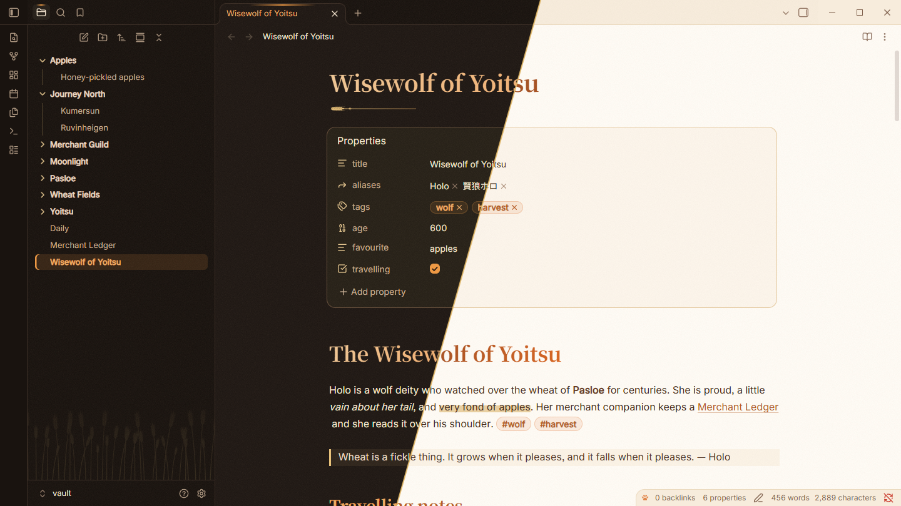
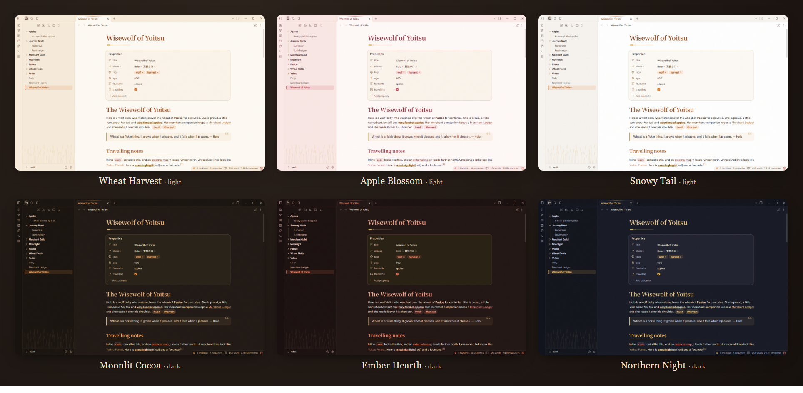
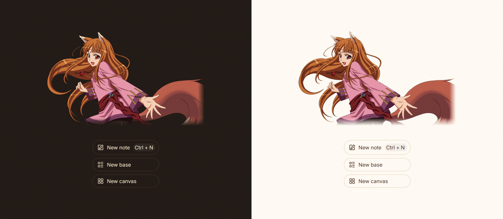
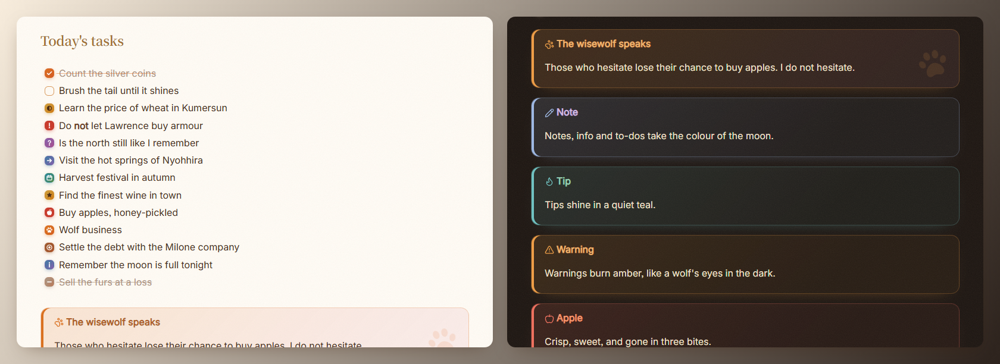

# Horo · 賢狼

**Wheat fields, amber eyes, apples and moonlight.**

An Obsidian theme inspired by Holo (Horo), the Wisewolf of Yoitsu from *Spice and Wolf*. Warm parchment, glowing amber, soft blush and hand-drawn wheat. It aims to be cute without getting in the way of your writing.



## Highlights

- **Six palettes:** three light and three dark, each with its own personality.
- **Character art and harvest ornaments:** Horo welcomes you on every new tab with flowing copper hair, red eyes and a rose-pink tunic. A wheat field grows at the foot of the file explorer, and dividers become wheat ears around a crescent moon.
- **Storybook typography:** a gradient note title with a wheat-sprig flourish, serif headings, and a fading underline on level-two headings.
- **Harvest-coloured details:** nested bullets in wheat, blush, leaf and moon colours; marker-pen highlights; pill tags; and rounded, gently striped tables.
- **Custom callouts:** `horo`, `apple`, `wheat`, `coin`, `moon`, `wine` and `journey`, plus restyled built-in callouts.
- **Alternate checkboxes:** a dozen task states, including apples, paw prints and silver coins.
- **Paper grain:** a barely-there texture over the workspace that you can switch off.
- **Respects your accent colour:** pick any accent in *Settings → Appearance* and links, headings, buttons and the active file all follow it.
- **[Style Settings](https://github.com/mgmeyers/obsidian-style-settings) support:** switch palettes and toggle every ornament.

## Palettes



| Mode  | Palette                     | Mood                                             |
| ----- | --------------------------- | ------------------------------------------------ |
| Light | **Wheat Harvest** (default) | Warm parchment and amber                         |
| Light | Apple Blossom               | Rosy and sweet                                   |
| Light | Snowy Tail                  | Clean white with amber, like the tip of her tail |
| Dark  | **Moonlit Cocoa** (default) | A warm night by the fire                         |
| Dark  | Ember Hearth                | Deep red embers                                  |
| Dark  | Northern Night              | Indigo sky over Yoitsu, with golden moonlight    |

Choose palettes with the Style Settings plugin. Without it, Horo uses Wheat Harvest and Moonlit Cocoa.

## The wisewolf on your empty tabs



## Tasks and callouts



### Callouts

```md
> [!horo] The wisewolf speaks
> Those who hesitate lose their chance to buy apples.
```

| Type                       | Colour    | Icon                            |
| -------------------------- | --------- | ------------------------------- |
| `horo`, `wolf`, `wisewolf` | Amber     | Paw print, plus a paw watermark |
| `apple`                    | Apple red | Apple                           |
| `wheat`, `harvest`         | Wheat     | Wheat                           |
| `coin`, `ledger`, `trade`  | Copper    | Coins                           |
| `moon`, `night`            | Moon blue | Moon                            |
| `wine`, `ale`              | Dusk      | Wine glass                      |
| `journey`, `road`, `map`   | Leaf      | Map                             |

All of Obsidian's built-in callouts (note, tip, warning and the rest) are restyled to match.

### Alternate checkboxes

| Syntax  | Meaning     | Syntax  | Meaning          |
| ------- | ----------- | ------- | ---------------- |
| `- [x]` | Done        | `- [*]` | Star             |
| `- [/]` | In progress | `- [a]` | Apple            |
| `- [-]` | Cancelled   | `- [w]` | Wolf / paw print |
| `- [>]` | Forwarded   | `- [$]` | Coin / money     |
| `- [<]` | Scheduled   | `- [i]` | Info             |
| `- [!]` | Important   | `- [?]` | Question         |

## Installation

**From Obsidian:** once Horo is listed in the community themes, open *Settings → Appearance → Themes → Manage*, search for **Horo**, then install it and select it.

**Manually:**

1. Create the folder `<your vault>/.obsidian/themes/Horo/`.
2. Copy `theme.css` and `manifest.json` from this repository into it.
3. Select **Horo** in *Settings → Appearance → Themes*.

## Style Settings

Install the [Style Settings](https://github.com/mgmeyers/obsidian-style-settings) plugin to tune the theme:

| Section             | Option                                                                               |
| ------------------- | ------------------------------------------------------------------------------------ |
| Palettes            | Light palette, dark palette                                                          |
| Ornaments           | Paper grain, gradient headings, wheat ornaments, wheat field, Horo on empty tabs     |
| Lists & files       | Paw-print bullets, single-colour bullets, harvest-coloured folders                   |
| Editor & typography | Active-line highlight, storybook serif body text, readable line length, display font |

## Fonts

Horo does not download fonts. It uses these fonts when they are installed and falls back gracefully when they are not:

| Role                   | Preferred fonts                                                                                                  | Fallback         |
| ---------------------- | ---------------------------------------------------------------------------------------------------------------- | ---------------- |
| Title and headings 1–3 | [Fraunces](https://fonts.google.com/specimen/Fraunces), Cormorant Garamond, Playfair Display, Noto Serif SC / JP | Georgia          |
| Interface and text     | [Nunito](https://fonts.google.com/specimen/Nunito), Quicksand, M PLUS Rounded 1c, Hiragino Maru Gothic           | System UI font   |
| Code                   | JetBrains Mono, Cascadia Code, Fira Code                                                                         | System monospace |

For the full storybook look, install **Fraunces** and **Nunito**. You can also set any font yourself in *Settings → Appearance → Font*.

## Credits

- Holo and *Spice and Wolf* (狼と香辛料) are the creations of Isuna Hasekura, illustrated by Jū Ayakura. Horo is an unofficial fan theme and is not affiliated with the original work or its publishers.
- The artwork in this theme (the peeking wolf, wheat field, ornaments and task icons) was drawn for Horo as inline SVG.
- Callout icons come from [Lucide](https://lucide.dev), which ships with Obsidian.
